

  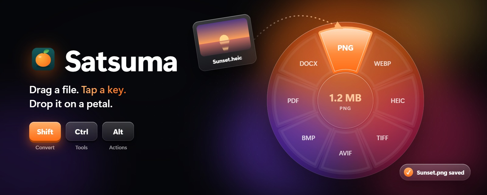

  

  
  
  
  
  

  <a href="README.md">English</a> · <b>فارسی</b>

  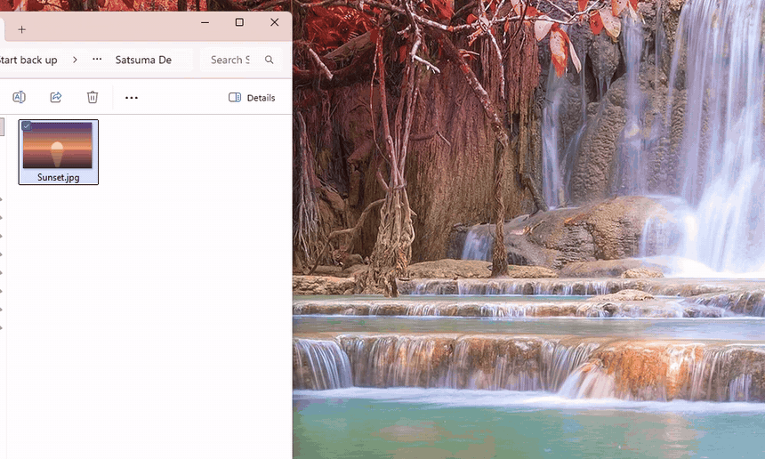
   
  <a href="docs/media/demo.mp4">تماشا به‌صورت ویدیو (MP4)</a>

**ساتسوما** هر بار کشیدن فایل را به یک میان‌بر تبدیل می‌کند. وقتی فایلی را می‌کشید، یک بار
**Shift**، **Ctrl** یا **Alt** را بزنید تا چرخی از گزینه‌ها درست زیر نشانگر باز شود. فایل را روی یک
گلبرگ رها کنید و نتیجه کنار فایل اصلی ذخیره می‌شود: عکس PNG می‌شود، ویدیو کم‌حجم می‌شود،
PDFها یکی می‌شوند و عکس پس‌زمینه می‌گیرد. همه‌چیز روی کامپیوتر خودتان انجام می‌شود و چیزی
آپلود نمی‌شود.

این نسخه‌ی ویندوزی [Satsuma](https://github.com/sonatina-dream/satsuma) از sonatina-dream است که
به‌شکل بومی برای ویندوز ۱۱ و با ظاهر *Liquid Glass* خودش ساخته شده.

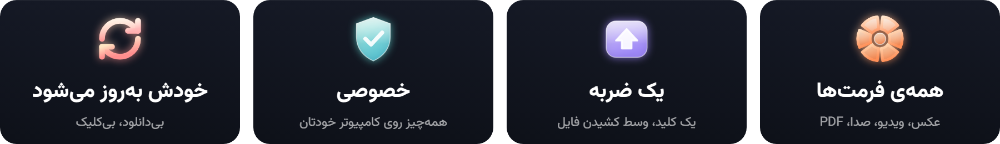

---

## 🎡 سه چرخ، یک حرکت

<table>
  <tr>
    <td width="33%" align="center">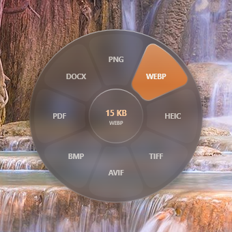</td>
    <td width="33%" align="center">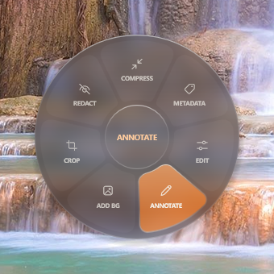</td>
    <td width="33%" align="center">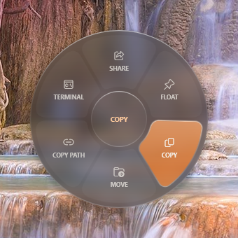</td>
  </tr>
  <tr>
    <td dir="rtl"><b>Shift: تبدیل.</b> همه‌ی فرمت‌هایی که این فایل می‌تواند بشود. وسط چرخ، حجم نتیجه را قبل از رها کردن نشان می‌دهد.</td>
    <td dir="rtl"><b>Ctrl: ابزارها.</b> فشرده‌سازی، کوتاه کردن، برش، ویرایش، یادداشت‌گذاری، پوشاندن، مرتب کردن صفحه‌ها، ویرایش مشخصات و بیشتر.</td>
    <td dir="rtl"><b>Alt: کارها.</b> اشتراک‌گذاری، Float، کپی، جابه‌جایی، کپی مسیر و باز کردن ترمینال همان‌جا.</td>
  </tr>
</table>

۱. یک یا چند فایل را **شروع به کشیدن** کنید؛ از File Explorer، دسکتاپ یا هر برنامه‌ای. 
۲. در حالی که کلیک را نگه داشته‌اید **یک بار یک کلید را بزنید**. کلید دیگر، چرخ را عوض می‌کند. 
۳. **روی یک گلبرگ رها کنید.** رها کردن در وسط، کار را لغو می‌کند.

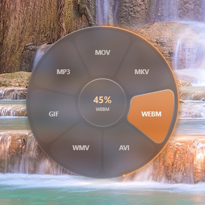

**چرخ کار را نشان می‌دهد.** بعد از رها کردن، چرخ سر جایش می‌ماند: حلقه‌ی باریکی از نور لبه‌اش را
پر می‌کند و وسط چرخ درصد را می‌شمارد. نشانگر را روی وسط ببرید تا **Cancel** ظاهر شود؛ وقتی کار تمام شد
تیک می‌خورد. یک پنل کوچک هم نتیجه را خبر می‌دهد:

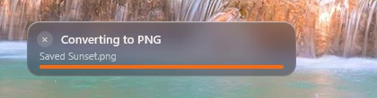

فایلی برای کشیدن ندارید؟ گزینه‌ی **Convert Files…** در منوی ساتسوما همین چرخ را برای فایل‌هایی که
انتخاب می‌کنید باز می‌کند؛ با کلیدهای جهت حرکت کنید و Enter را بزنید.

 

## 🔁 چه چیزهایی را تبدیل می‌کند

| | تبدیل به |
| --- | --- |
| 🖼 **عکس**: JPG، PNG، WebP، HEIC، AVIF، TIFF، BMP، SVG | به یکدیگر، PDF یا Word (متن عکس خوانده می‌شود) |
| 🎬 **ویدیو**: MP4، MOV، MKV، WebM، AVI، WMV | به یکدیگر، GIF یا MP3 |
| 🎵 **صدا**: MP3، M4A، WAV، FLAC، OGG، Opus، AIFF، WMA | به یکدیگر |
| 📄 **PDF** | Word، **PowerPoint**، **Excel**، JPG، PNG، EPUB، TXT، Markdown |
| 📽 **اسلاید**: PowerPoint (PPT، PPTX) | PDF، JPG، PNG |
| 📝 **سند**: Word، Markdown، RTF، HTML، TXT، EPUB | PDF، Word، TXT، HTML، EPUB، PNG، JPG |
| 📊 **جدول**: Excel، ODS، CSV، TSV | به یکدیگر یا PDF |
| 🗜 **فایل فشرده**: ZIP، TAR، GZ | به یکدیگر |

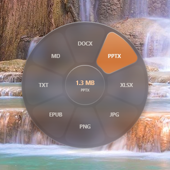

- **PDF به PowerPoint** هر صفحه را روی یک اسلاید می‌گذارد.
- **PDF به Excel** صفحه‌ها را می‌خواند (اسکن‌شده‌ها را هم) و متن را در ردیف و ستون می‌چیند.
- **اسلاید به PDF** با Microsoft PowerPoint انجام می‌شود، و اگر PowerPoint نباشد با LibreOffice.

عکس، سند، PDF، جدول، زیرنویس و فایل فشرده بدون نیاز به چیز دیگری کار می‌کنند. برای صدا و
ویدیو [ffmpeg](https://ffmpeg.org) لازم است: `winget install Gyan.FFmpeg`

 

## 🧰 ابزارها

خیلی از ابزارها اول یک پنجره‌ی کوچک باز می‌کنند تا دقیقاً انتخاب کنید چه بشود. همه‌ی این‌ها روی
کامپیوتر خودتان انجام می‌شود.

### 🖼 عکس

<table>
  <tr>
    <td width="50%">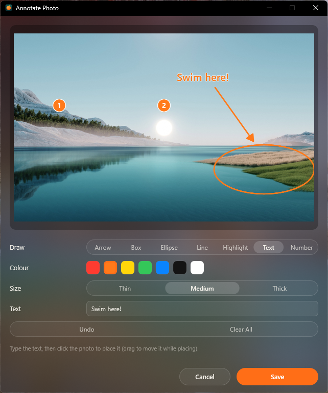</td>
    <td width="50%">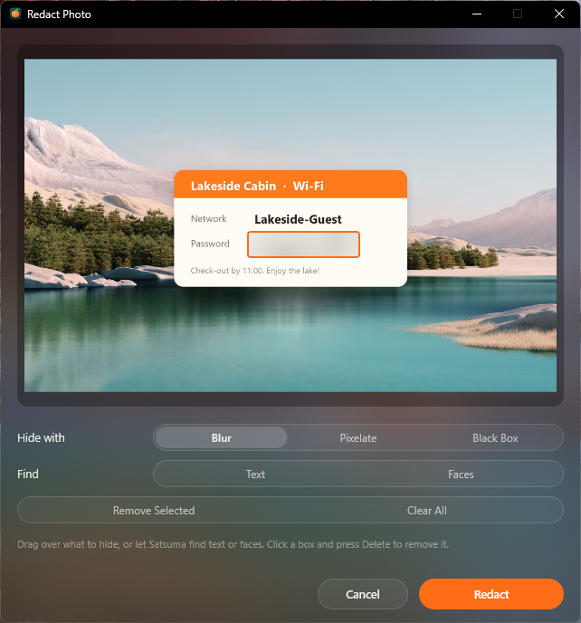</td>
  </tr>
  <tr>
    <td dir="rtl"><b>یادداشت‌گذاری</b>: فلش، کادر، بیضی، خط، هایلایت، متن و نشانگر شماره‌دار، با هفت رنگ و سه ضخامت.</td>
    <td dir="rtl"><b>پوشاندن</b>: هر جا را علامت بزنید محو، پیکسلی یا سیاه می‌شود. <b>Find Text</b> و <b>Find Faces</b> نوشته‌ها و چهره‌ها را خودشان علامت می‌زنند.</td>
  </tr>
</table>

<table>
  <tr>
    <td width="33%">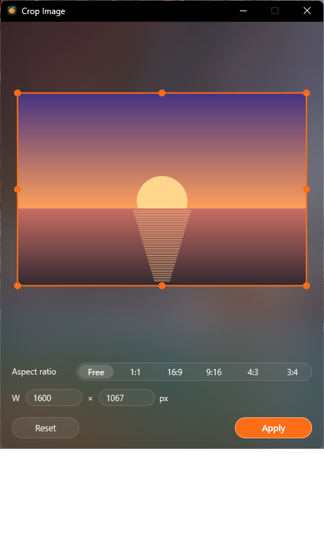</td>
    <td width="33%">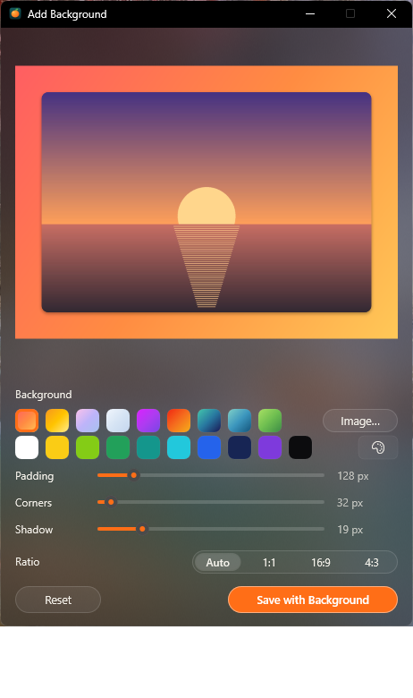</td>
    <td width="33%">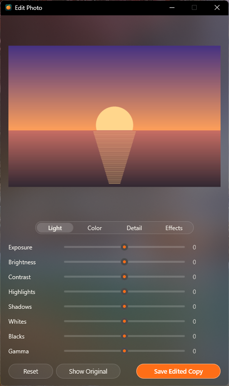</td>
  </tr>
  <tr>
    <td align="center" dir="rtl"><b>برش عکس</b>: نسبت‌های آماده یا اندازه‌ی دقیق</td>
    <td align="center" dir="rtl"><b>افزودن پس‌زمینه</b>: گرادیان، رنگ یا عکس خودتان</td>
    <td align="center" dir="rtl"><b>ویرایش عکس</b>: ۲۰ تنظیم با پیش‌نمایش زنده</td>
  </tr>
</table>

همچنین: **فشرده‌سازی** (با شدت دلخواه یا تا حجم مشخص، و حداکثر اندازه‌ی ضلع)، **حذف متادیتا**
(مشخصات دوربین و GPS)، و برای چند عکس **ساخت PDF** و **کلاژ** (شبکه، ردیف یا ستون، با فاصله و رنگ
پس‌زمینه).

### 🎬 ویدیو

<table>
  <tr>
    <td width="33%">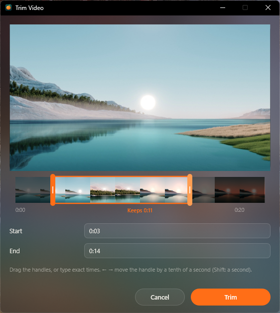</td>
    <td width="33%">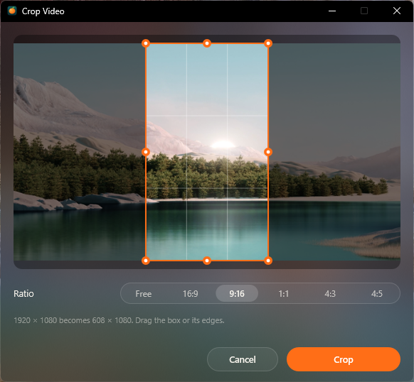</td>
    <td width="33%">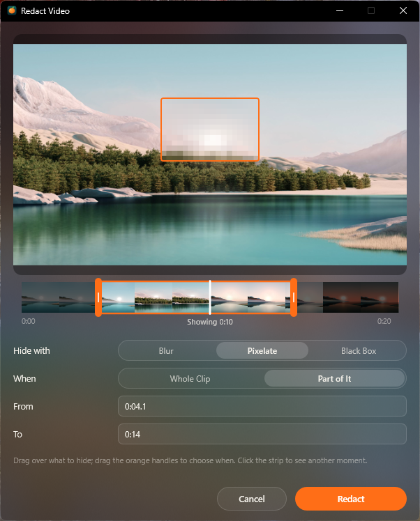</td>
  </tr>
  <tr>
    <td dir="rtl"><b>کوتاه کردن</b>: دسته‌ها را روی نوار فریم‌ها بکشید و پیش‌نمایش بزرگ را ببینید، یا زمان دقیق را تایپ کنید.</td>
    <td dir="rtl"><b>برش</b>: کادر را بکشید، یا ۱۶:۹، ۹:۱۶، ۱:۱، ۴:۳ یا ۴:۵ را بزنید.</td>
    <td dir="rtl"><b>پوشاندن</b>: کادرها محو، پیکسلی یا سیاه می‌شوند؛ در کل ویدیو یا فقط یک بخش.</td>
  </tr>
</table>

<table>
  <tr>
    <td width="50%">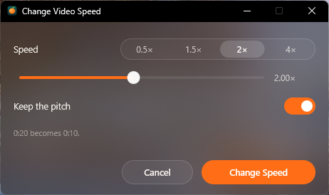</td>
    <td width="50%">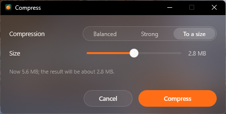</td>
  </tr>
  <tr>
    <td dir="rtl"><b>سرعت</b>: از ۰٫۲۵ تا ۴ برابر؛ اگر بخواهید زیر و بمی صدا عوض نمی‌شود.</td>
    <td dir="rtl"><b>فشرده‌سازی</b>: Balanced، Strong، یا <b>تا یک حجم مشخص</b> که جایی که می‌فرستید قبول کند.</td>
  </tr>
</table>

همچنین: **عکس از فریم‌ها** (۱ تا ۳۰ فریم در طول ویدیو، PNG یا JPG)، **تقسیم** (به چند قسمت مساوی
یا تکه‌هایی با طول مشخص)، **بی‌صدا کردن**، **ویرایش مشخصات**، و برای چند ویدیو **اتصال**.

### 🎵 صدا

<table>
  <tr>
    <td width="50%">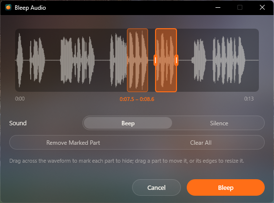</td>
    <td width="50%">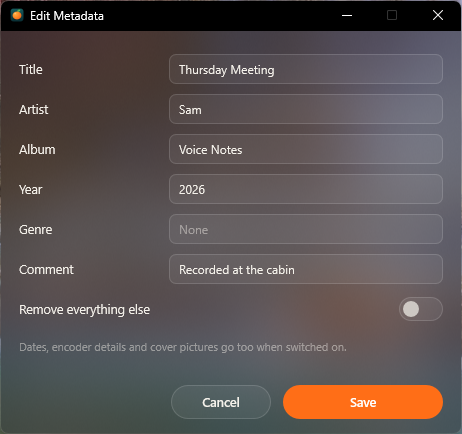</td>
  </tr>
  <tr>
    <td dir="rtl"><b>بیپ</b>: بخش‌هایی را روی موج صدا علامت بزنید تا بیپ یا بی‌صدا شوند.</td>
    <td dir="rtl"><b>ویرایش مشخصات</b>: عنوان، هنرمند، آلبوم، سال، سبک و توضیح؛ یا پاک کردن همه.</td>
  </tr>
</table>

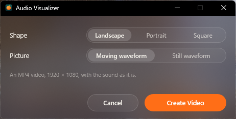

همچنین: **کوتاه کردن** روی موج صدا (یا فقط حذف سکوت اول و آخر)، **مونو/استریو** با تنظیم بلندی
هر طرف، **یکسان‌سازی صدا**، **فشرده‌سازی** و **صدا به ویدیو** (افقی، عمودی یا مربع، با موج متحرک یا
ثابت).

 

### 📄 PDF

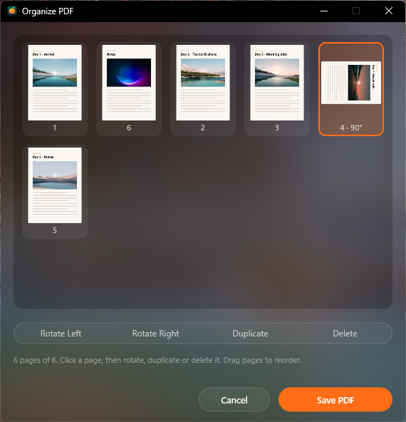

**مرتب کردن صفحه‌ها**: همه‌ی صفحه‌ها به‌صورت تصویر کوچک. با کشیدن ترتیبشان را عوض کنید، بچرخانید،
تکرار یا حذف کنید و ذخیره کنید.

همچنین: **فشرده‌سازی**، **تقسیم**، **ویرایش مشخصات** (عنوان، نویسنده، موضوع و کلیدواژه‌ها)، و برای
چند PDF **ادغام**.

 

### 📌 Float

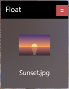

**Float** فایل‌ها را در یک قفسه‌ی کوچک که همیشه رو است دم دست نگه می‌دارد؛ هر وقت لازم شد
آن‌ها را به هر برنامه‌ای بکشید.

 

## 🎨 شیشه‌ی مایع

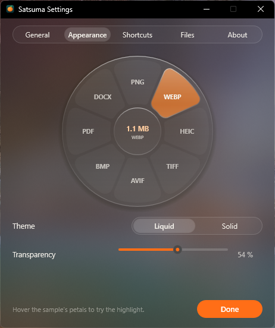

- **Liquid**: شیشه‌ی مات که پشتش را محو می‌کند، با هایلایتی که مثل مایع بین گلبرگ‌ها جاری
  می‌شود.
- **Solid**: چرخ مات با رنگ‌های روشن یا تیره‌ی ویندوز.
- یک **اسلایدر شفافیت** برای هر دو، و پیش‌نمایش زنده برای امتحان کردنشان.

 

## ⚙️ به سلیقه‌ی خودتان

<table>
  <tr>
    <td width="33%">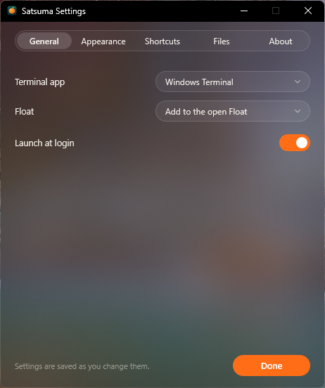</td>
    <td width="33%">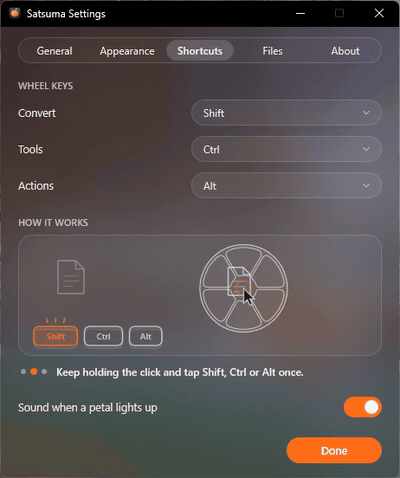</td>
    <td width="33%">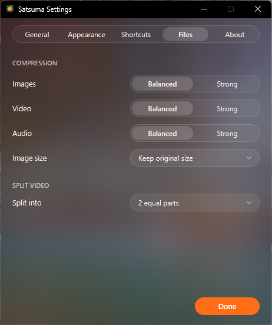</td>
  </tr>
  <tr>
    <td align="center" dir="rtl"><b>General</b>: برنامه‌ی ترمینال، Float، اجرا هنگام ورود</td>
    <td align="center" dir="rtl"><b>Shortcuts</b>: کلید هر چرخ</td>
    <td align="center" dir="rtl"><b>Files</b>: شدت فشرده‌سازی، اندازه‌ی عکس، تعداد تکه‌های ویدیو</td>
  </tr>
</table>

## 🔄 همیشه به‌روز

ساتسوما خودش نسخه‌های جدید را پیدا می‌کند و در پس‌زمینه دانلود می‌کند. وقتی آماده شد، وسط چرخ
**Update ready** نوشته می‌شود:

- **فایل‌هایتان را همان‌جا رها کنید** تا ساتسوما همان لحظه به‌روز شود و دوباره باز شود، یا
- هیچ کاری نکنید: همین که بیکار شد خودش به‌روز می‌شود و با نسخه‌ی جدید برمی‌گردد.

در *Settings › About* هم می‌توانید خودتان بررسی کنید.

## 📦 نصب

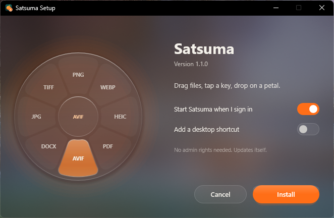

۱. فایل **[Satsuma-Setup.exe](https://github.com/thesaikodelik/satsuma-windows/releases/latest/download/Satsuma-Setup.exe)** را دانلود کنید. 
۲. اجرایش کنید و **Install** را بزنید. فقط برای حساب شما نصب می‌شود و **دسترسی مدیر لازم ندارد**. 
۳. آیکون پرتقالی ساتسوما در انتهای سمت راست تسک‌بار ظاهر می‌شود (شاید زیر **^** باشد).

> برنامه‌های تازه ممکن است تا وقتی زیاد دانلود نشده‌اند پیام *Windows protected your PC* بگیرند.
> **More info** و بعد **Run anyway** را بزنید. ساتسوما متن‌باز است؛ می‌توانید همه‌ی کدش را
> بخوانید یا خودتان آن را بسازید.

برای حذف از **Settings → Apps** ویندوز استفاده کنید. می‌توانید تنظیماتتان را نگه دارید.

 

## 🗂 تازه‌ها

جدیدترین نسخه، فایل‌هایش و **همه‌ی تغییرات همه‌ی نسخه‌ها تا امروز** در
**[آخرین ریلیز](https://github.com/thesaikodelik/satsuma-windows/releases/latest)** است. فقط به همان
نیاز دارید؛ بعد از آن ساتسوما خودش به‌روز می‌شود.

## 🔒 حریم خصوصی

فایل‌های شما هیچ‌وقت از کامپیوترتان خارج نمی‌شوند. ساتسوما فقط برای پرسیدن از GitHub که نسخه‌ی
جدیدی هست یا نه به اینترنت وصل می‌شود. بدون حساب کاربری، بدون تبلیغ و بدون ردیابی.

## 🛠 ساختن از کد

راهنمای ساخت، خط فرمان و ساختار پروژه در [README انگلیسی](README.md) (بخش Build from source) است.

## 💛 قدردانی

- [**Satsuma**](https://github.com/sonatina-dream/satsuma) از **sonatina-dream**، برنامه‌ی مک که این
  نسخه از آن ساخته شده.
- ایده‌ی کار از [Tangerine](https://tangerineformac.com) برای مک گرفته شده.
- آیکون‌های کارت‌ها: [Fluent Emoji](https://github.com/microsoft/fluentui-emoji) از مایکروسافت (MIT).
- نسخه‌ی ویندوز از [**thesaikodelik**](https://github.com/thesaikodelik). اگر وقتتان را صرفه‌جویی
  کرد، می‌توانید [یک قهوه مهمانم کنید](https://github.com/sponsors/thesaikodelik). ☕

منتشرشده با [مجوز MIT](LICENSE).

