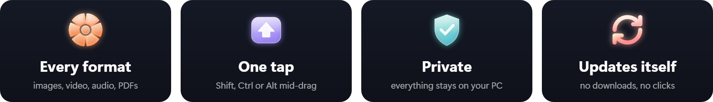

<p align="center">
  
</p>

<p align="center">
  <a href="https://github.com/thesaikodelik/satsuma-windows/releases/latest/download/Satsuma-Setup.exe"></a>
</p>

<p align="center">
  
  
  
  
  
</p>

<p align="center">
  <b>English</b> · <a href="README.fa.md">فارسی</a>
</p>

<p align="center">
  
  <br>
  <sub><a href="docs/media/demo.mp4">Watch it as a video (MP4)</a></sub>
</p>

**Satsuma** turns every file drag into a shortcut. While you drag files, tap **Shift**, **Ctrl** or
**Alt** and a wheel of options opens right under your pointer. Drop onto a petal and the result is
saved next to the original: a photo becomes a PNG, a video gets smaller, PDFs merge, a picture gets a
background. Everything happens on your PC; nothing is uploaded.

This is the Windows edition of [Satsuma](https://github.com/sonatina-dream/satsuma) by
sonatina-dream, rebuilt natively for Windows 11 with a *Liquid Glass* look of its own.

<p align="center"></p>

<p align="center">
  <a href="#-how-it-works">How it works</a> ·
  <a href="#-what-it-converts">What it converts</a> ·
  <a href="#-tools">Tools</a> ·
  <a href="#-look-and-settings">Look and settings</a> ·
  <a href="#-install">Install</a> ·
  <a href="#-always-up-to-date">Updates</a> ·
  <a href="#-private-by-design">Privacy</a>
</p>

---

## 🎡 How it works

1. **Start dragging** one or more files, from File Explorer, the desktop or any app.
2. **Tap a key once** while you hold the click. Tap another key to switch wheels.
3. **Drop on a petal.** Drop in the middle to cancel.

<table>
  <tr>
    <td width="33%"></td>
    <td width="33%"></td>
    <td width="33%"></td>
  </tr>
  <tr>
    <td valign="top"><b>Shift: Convert.</b> Every format this file can become. The hub shows the result's size before you drop.</td>
    <td valign="top"><b>Ctrl: Tools.</b> Compress, trim, crop, edit, annotate, redact, organize pages, edit tags and more.</td>
    <td valign="top"><b>Alt: Actions.</b> Share, Float, Copy, Move, Copy Path and open a Terminal there.</td>
  </tr>
</table>

### The wheel shows the work

<table>
  <tr>
    <td width="50%"></td>
    <td width="50%"></td>
  </tr>
  <tr>
    <td valign="top">After you drop, the wheel stays put: a thin <b>ring of light</b> fills along its edge and the hub counts the percent. Hover the hub to <b>Cancel</b>; a tick shows when it's done.</td>
    <td valign="top">When there's no wheel to show it on (a job from a tool window, or one still running when you start a new drag), a <b>small panel</b> shows the progress instead. Its <b>×</b> cancels, and it tells you if something goes wrong.</td>
  </tr>
</table>

No drag handy? **Convert Files…** in Satsuma's menu opens the same wheel for files you pick; arrow
keys move around it, Enter applies.

## 🔁 What it converts

| | Convert to |
| --- | --- |
| 🖼 **Images**: JPG, PNG, WebP, HEIC, AVIF, TIFF, BMP, SVG | each other, PDF or Word (text is recognised) |
| 🎬 **Video**: MP4, MOV, MKV, WebM, AVI, WMV, GIF | each other, GIF or MP3 |
| 🎵 **Audio**: MP3, M4A, WAV, FLAC, OGG, Opus, AIFF, WMA | each other |
| 📄 **PDF** | Word, **PowerPoint**, **Excel**, JPG, PNG, EPUB, TXT, Markdown |
| 📽 **Slides**: PowerPoint (PPT, PPTX) | PDF, JPG, PNG |
| 📝 **Documents**: Word, Markdown, RTF, TXT, EPUB | PDF, Word, TXT, Markdown, HTML, EPUB, PNG, JPG |
| 📊 **Spreadsheets**: Excel (XLSX, XLS), ODS, CSV, TSV | each other or PDF |
| 💬 **Subtitles**: SRT, VTT | each other or TXT |
| 🗜 **Archives**: ZIP, TAR, GZ, RAR | ZIP, TAR or GZ; or **Extract** them |

- **PDF → PowerPoint** puts each page on its own slide.
- **PDF → Excel** reads the pages, scanned ones too, and lays the text out in rows and columns.
- **Slides → PDF** uses Microsoft PowerPoint, or LibreOffice when there's no PowerPoint.

> **What needs extra software:** audio and video use [ffmpeg](https://ffmpeg.org)
> (`winget install Gyan.FFmpeg`), which also brings WebP and AVIF output, PNG compression and
> collages. HEIC output needs the HEIF and HEVC extensions from the Microsoft Store. Everything else
> works out of the box, and petals your PC can't do yet are simply hidden.

## 🧰 Tools

Many tools open a small window first, so you choose exactly what happens.

### 🖼 Photos

<table>
  <tr>
    <td width="50%"></td>
    <td width="50%"></td>
  </tr>
  <tr>
    <td valign="top"><b>Annotate</b>: arrows, boxes, ellipses, lines, highlights, text and numbered markers, in seven colours and three sizes.</td>
    <td valign="top"><b>Redact</b>: blur, pixelate or black out what you mark. <b>Find Text</b> and <b>Find Faces</b> mark them for you.</td>
  </tr>
</table>

<table>
  <tr>
    <td width="33%"></td>
    <td width="33%"></td>
    <td width="33%"></td>
  </tr>
  <tr>
    <td valign="top"><b>Crop Image</b>: presets or an exact size.</td>
    <td valign="top"><b>Add Background</b>: gradients, colours or your own image.</td>
    <td valign="top"><b>Edit Photo</b>: 20 adjustments with a live preview.</td>
  </tr>
</table>

Also **Compress** (to a strength or a size, with a longest edge) and **Remove Metadata** (camera and
GPS details). For several photos: **Create PDF** and **Collage** (grid, row or column, with spacing
and a background colour).

### 🎬 Video

<table>
  <tr>
    <td width="33%"></td>
    <td width="33%"></td>
    <td width="33%"></td>
  </tr>
  <tr>
    <td valign="top"><b>Trim</b>: drag the handles on the filmstrip, with a large preview, or type exact times.</td>
    <td valign="top"><b>Crop</b>: drag the box, or pick 16:9, 9:16, 1:1, 4:3 or 4:5.</td>
    <td valign="top"><b>Redact</b>: blur, pixelate or black out boxes, for the whole clip or just part of it.</td>
  </tr>
</table>

<table>
  <tr>
    <td width="50%"></td>
    <td width="50%"></td>
  </tr>
  <tr>
    <td valign="top"><b>Speed</b>: 0.25× to 4×, keeping the pitch of the voice if you like.</td>
    <td valign="top"><b>Compress</b>: Balanced, Strong, or <b>to a size</b> that fits where you're sending it.</td>
  </tr>
</table>

Also **Snapshots** (1 to 30 frames spread through the clip, PNG or JPG), **Split** (into equal parts
or clips of a set length), **Mute** and **Edit Metadata**. For several clips: **Join**. Video tools
work on MP4, MOV and MKV; convert other videos to one of those first.

### 🎵 Audio

<table>
  <tr>
    <td width="33%"></td>
    <td width="33%"></td>
    <td width="33%"></td>
  </tr>
  <tr>
    <td valign="top"><b>Bleep</b>: mark parts on the waveform; they get a beep or silence.</td>
    <td valign="top"><b>Edit Metadata</b>: title, artist, album, year, genre and comment, or remove everything.</td>
    <td valign="top"><b>Audio → Video</b>: landscape, portrait or square, with a moving or still waveform.</td>
  </tr>
</table>

Also **Trim** on the waveform (or just cut the silence at both ends), **Mono / Stereo** with the
volume of each side, **Normalize** and **Compress**. Audio tools work on MP3, M4A, WAV and FLAC.

### 📄 PDF

<table>
  <tr>
    <td width="50%"></td>
    <td width="50%"></td>
  </tr>
  <tr>
    <td valign="top"><b>Organize Pages</b>: every page as a thumbnail. Drag pages into a new order, turn them, duplicate or delete them, then save.</td>
    <td valign="top"><b>Convert</b> to Word, PowerPoint, Excel, images, EPUB, text or Markdown.</td>
  </tr>
</table>

Also **Compress**, **Split** and **Edit Info** (title, author, subject and keywords). For several
PDFs: **Merge**.

### 📌 Float

<table>
  <tr>
    <td width="130"></td>
    <td><b>Float</b> keeps files at hand in a small shelf that stays on top; drag them out again into any app when you need them. Send files to it from the Actions wheel.</td>
  </tr>
</table>

## 🎨 Look and settings

- **Liquid**: frosted glass that blurs whatever is behind it, with a highlight that flows like
  liquid from petal to petal as you move.
- **Solid**: an opaque wheel in Windows' light or dark colours.
- A **Transparency** slider for both, and a live preview to try them on.

<table>
  <tr>
    <td width="25%"></td>
    <td width="25%"></td>
    <td width="25%"></td>
    <td width="25%"></td>
  </tr>
  <tr>
    <td valign="top"><b>Appearance</b>: theme and transparency.</td>
    <td valign="top"><b>General</b>: terminal app, Float, start at sign-in.</td>
    <td valign="top"><b>Shortcuts</b>: the key for each wheel.</td>
    <td valign="top"><b>Files</b>: compression, image size, video parts.</td>
  </tr>
</table>

## 📦 Install

<table>
  <tr>
    <td width="50%" valign="top">

1. Download **[Satsuma-Setup.exe](https://github.com/thesaikodelik/satsuma-windows/releases/latest/download/Satsuma-Setup.exe)**.
2. Run it and click **Install**. It installs just for you, **no administrator rights needed**.
3. Satsuma's citrus icon appears at the right end of the taskbar (it may be under the **^**).

New apps can get *"Windows protected your PC"* until they're widely downloaded. Choose
**More info → Run anyway**. Satsuma is open source: read every line, or build it yourself.

Uninstall from **Settings → Apps**. You can keep your settings.

</td>
    <td width="50%"></td>
  </tr>
</table>

## 🔄 Always up to date

Satsuma checks for new versions on its own and downloads them in the background. When one is
ready, the middle of the wheel says **Update ready**:

- **Drop your files there** and Satsuma updates and restarts right away, or
- do nothing: it updates itself the moment it's idle and comes back on the new version.

You can also check yourself in *Settings › About*. Every version and everything that changed in it
is on the **[latest release](https://github.com/thesaikodelik/satsuma-windows/releases/latest)**.

## 🔒 Private by design

Your files never leave your PC. The only time Satsuma goes online is to ask GitHub whether a newer
version exists. No accounts, no ads, no tracking.

## ✍️ Code signing policy

Free code signing provided by [SignPath.io](https://about.signpath.io), certificate by
[SignPath Foundation](https://signpath.org). *Being set up: until it's in place, releases are
unsigned.*

- **Committers and reviewers:** [thesaikodelik](https://github.com/thesaikodelik)
- **Approvers:** [thesaikodelik](https://github.com/thesaikodelik)

Every signed file is built from this repository by [GitHub Actions](.github/workflows/windows.yml),
and each release is approved by hand before it's signed.

**Privacy:** Satsuma sends no information to other networked systems unless you ask it to, with one
exception: it asks GitHub whether a newer version of Satsuma exists, and downloads it when there is
(see [Private by design](#-private-by-design)).

<details>
<summary><b>🛠 Build from source, command line and how it works</b></summary>

### Build

Stable Rust with the MSVC toolchain.

```powershell
winget install Rustlang.Rustup
cargo build --release -p satsuma-app -p satsuma-setup   # satsuma.exe, satsuma-cli.exe, satsuma-setup.exe
cargo test --workspace
powershell -ExecutionPolicy Bypass -File scripts\package-windows.ps1   # dist\Satsuma-Setup.exe and the zip
```

### Command line

`satsuma-cli.exe help` lists every command; conversions, tools and capability checks all work from a
terminal.

### Layout

```
crates/
  satsuma-core/     formats, wheels, gestures and settings (shared with macOS)
  satsuma-engine/   conversions and tools; Windows services in src/win/
  satsuma-app/      the notification-area app, wheel, tool windows, Settings, updater and Setup (src/win/)
  satsuma-setup/    the installer's own executable, with its icon
```

Windows has no shared drag pasteboard, so Satsuma lets the drag announce itself: when a wheel key is
tapped while a button is held, an invisible drop target appears under the pointer, and only a real
file drag reaches it. More in [docs/WINDOWS.md](docs/WINDOWS.md).

</details>

## 💛 Credits

- [**Satsuma**](https://github.com/sonatina-dream/satsuma) by **sonatina-dream**, the macOS app this
  edition is built from.
- The workflow is inspired by [Tangerine](https://tangerineformac.com) for Mac.
- Icons in the highlights: [Fluent Emoji](https://github.com/microsoft/fluentui-emoji) by Microsoft (MIT).
- Windows edition by [**thesaikodelik**](https://github.com/thesaikodelik). If it saves you time,
  you can [buy me a coffee](https://github.com/sponsors/thesaikodelik). ☕

Released under the [MIT license](LICENSE).
